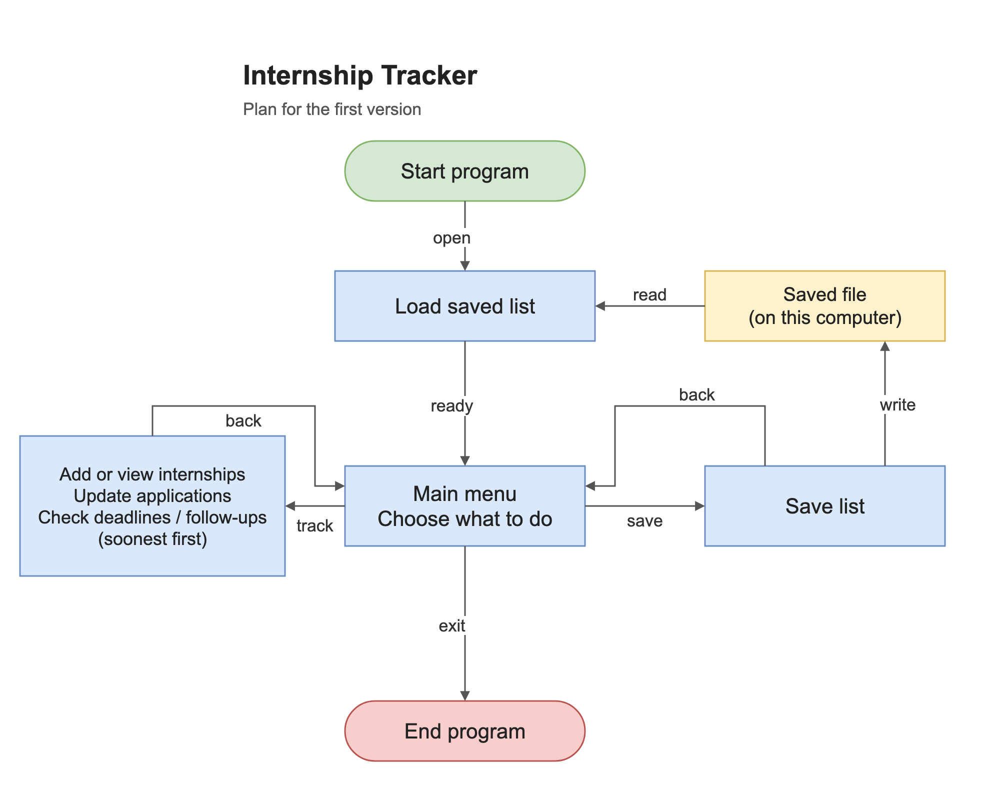

# Project design

## 1.1: The problem

When I look for internships, I end up with information in job websites, emails, and spreadsheets. It gets hard to remember where I applied, which deadlines are coming up, and who I need to follow up with. Since I'm applying for internships myself, I want one place to keep this information.

## 1.2: My idea

I'm going to build a Java program that runs in the terminal and lets me add internships, update their statuses, and check upcoming dates. It will save the list to a local file so I don't lose it when I close the program.

## 2.1: First version (MVP)

I want to add and view internships, update applications, save the list, and check upcoming dates. The list should still be there after closing and reopening the program. The [feature matrix](matrix.md) shows what goes in the first version and what can wait.

## 2.2: Tools

- Java 21 for the code.
- An `Internship` class for one internship's details.
- `ArrayList<Internship>` to keep the list while the program runs.
- `Scanner` to read what the user types.
- `LocalDate` and `DateTimeFormatter` to handle dates entered as `yyyy-MM-dd`.
- `Comparator` to sort upcoming dates.
- `Files` and `Path` to save and load the list.
- VS Code to edit files, and `javac` and `java` to compile and run them.
- Git and GitHub to save progress.

I'll enter the information myself, so this version doesn't need an API or a database.

## Basic plan

Each entry will have an ID, company, role, status, link, deadline, follow-up date, and notes. The link, dates, and notes can be left blank. Statuses will be Interested, Applied, Interviewing, Offer, and Rejected.

The program will load the list and show a menu with add, view, update, upcoming dates, save, and exit. IDs should stay the same after saving and loading.

The file will be `data/internships.tsv`, with one entry per line and tabs between fields. Text fields won't allow tabs or line breaks. The `data/` folder is ignored by Git so personal application details stay local.

I'll check invalid choices and dates, handle a missing file on the first run, and show an error if saving fails.

## 2.3: Build plan

See [the nine steps](plan.md). Only step 1 is done so far.

## 2.4: Diagram

This is an AI-generated reference draft. I still need to draw the final diagram myself for section 2.4. The tracking features shown also still need to be built.

[draw.io source for the draft](diagram.drawio)

## 3.1: GitHub link

[Internship Tracker](https://github.com/Adityapat101/internship-tracker)
